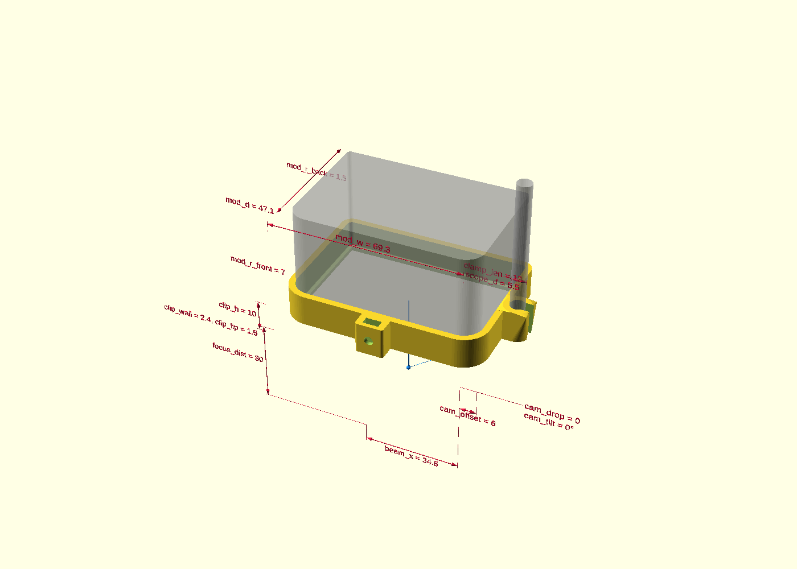
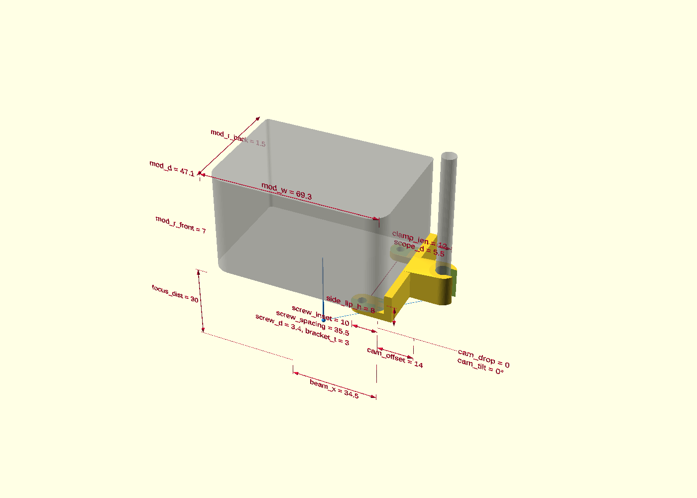
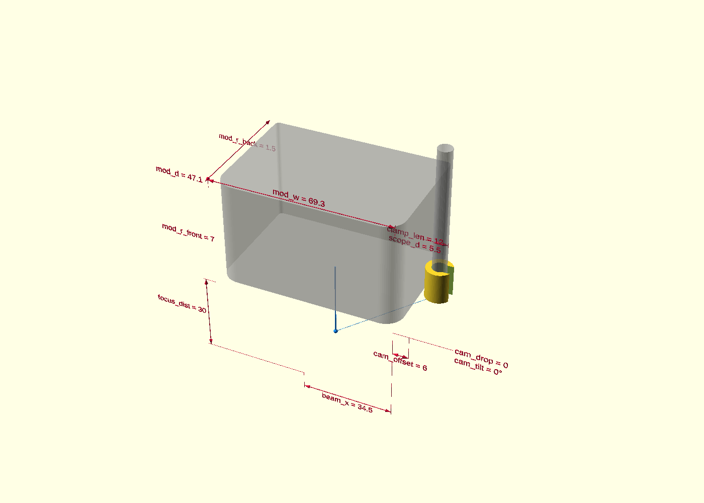
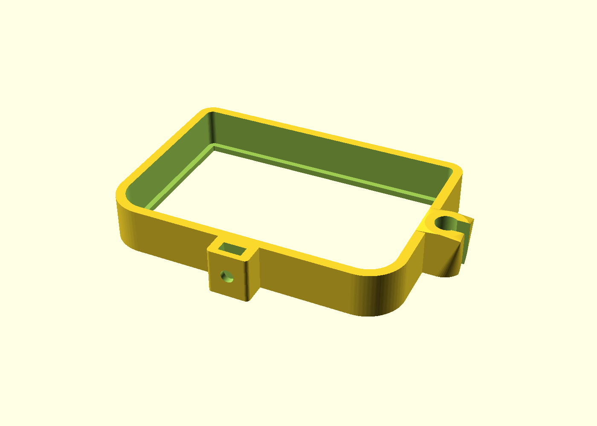
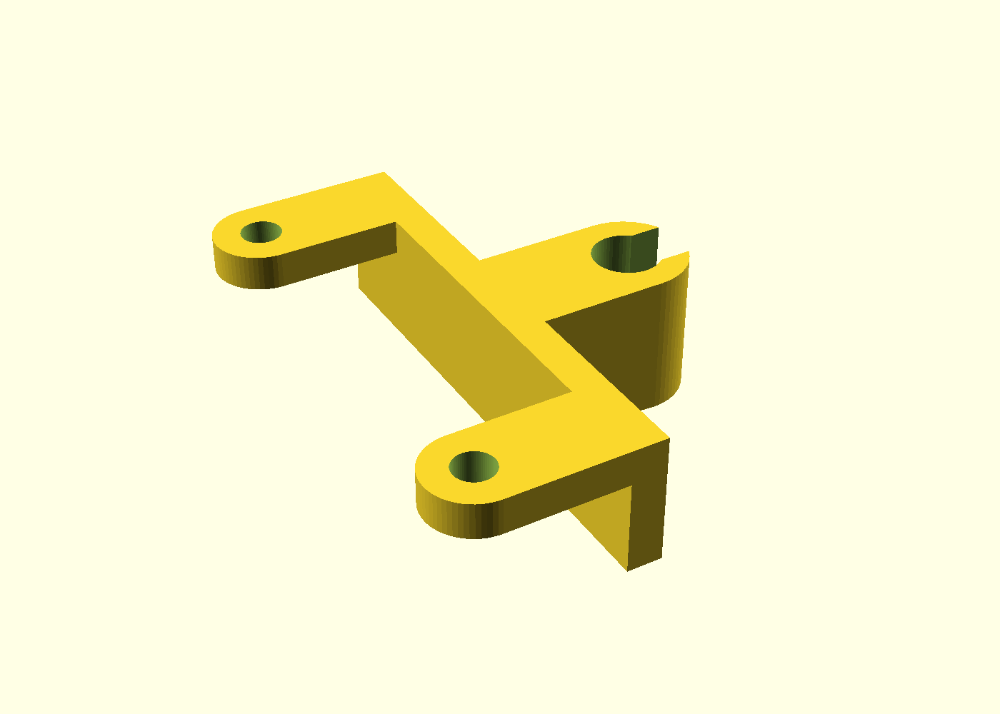

# Laser Endoscope Mount

A 3D-printable holder for a cheap USB endoscope camera on a diode laser module, so you can
watch the laser spot while engraving. The design is **parametric**: you type in the sizes of
your laser and your camera, and OpenSCAD builds a matching mount. No CAD skills needed.

## Mount types

| Clip | Bottom screws | Side plate |
|---|---|---|
|  |  |  |
| A band around the bottom of the module, held by one M3 screw. Works on almost any rectangular module, no drilling. | Uses two existing screws on the module's bottom. Needs two slightly longer screws. | Screws onto two threaded holes on the module's side. |

The camera always sits on the **right** side of the module (seen from the front of the
machine), below the module, looking at the laser spot.

## Ready-made presets

| Preset | Status | Hardware |
|---|---|---|
| Falcon A1 Pro 20W - clip | test-printed, fits | 1× M3×10 screw, 1× M3 nut |
| Falcon A1 Pro 20W - bottom screws | measured, test print pending | 2× M3×10 screws (replace the original M3×8) |
| Sculpfun C1 Mini - clip (not measured yet) | placeholder values, do not print | 1× M3×10 screw, 1× M3 nut |

If your laser is not listed, start with any clip preset and change the sizes (see below).

**Falcon A1 Pro 20W notes**: module 69.3 × 47.1 mm, corner radius about 7 mm at the front
and 1.5 mm at the back, beam 34.5 mm from the right face.
The bottom screws are M3×8, 35.5 mm apart, 10 mm in from the right face. The bracket adds
3 mm, so use M3×10: that still engages 7 mm of thread and cannot bottom out deeper than the
original screw. The clip band is 15 mm high; the side vents start at 27 mm, and the back
has a 6 mm gap to the Z column, enough for the 2.4 mm wall.

| Clip, ready to print | Bottom bracket, ready to print |
|---|---|
|  |  |

---

## 1. Install the software (once)

1. **OpenSCAD**: download a *development snapshot* from
   <https://openscad.org/downloads.html#snapshots> and install it.
   The old "stable" release 2021.01 works too, but it is very slow with this design.
2. **BOSL2 library**: download <https://github.com/BelfrySCAD/BOSL2/archive/refs/heads/master.zip>.
   - In OpenSCAD, click **File → Show Library Folder**. A folder opens.
   - Unzip the download into that folder and rename `BOSL2-master` to `BOSL2`.
   - The result must look like `.../OpenSCAD/libraries/BOSL2/std.scad`.

## 2. Open the design

1. Download this folder and keep `endoscope_mount.scad` and `endoscope_mount.json` together.
   The `.json` file holds the presets and is loaded automatically.
2. Double-click `endoscope_mount.scad` (or **File → Open** in OpenSCAD).
3. Turn on the slider panel: **Window → Customizer**.
4. Optional: hide the code with **Window → Hide Editor**. You never need to edit code.

<!-- TODO: screenshot of the Customizer panel with the preset dropdown -->

## 3. Pick a preset

At the top of the Customizer panel there is a dropdown. Choose the preset that matches your
laser. All sliders jump to the values of that preset.

Press **F5** (preview). You see:

- the mount (yellow),
- a transparent grey box: your laser module,
- a transparent rod: the endoscope,
- a blue line and dot: the laser beam and its focus point,
- red dimension lines, each labeled with the **exact name of its slider**
  (for example `cam_drop = 8`). Move a slider and watch which line changes.

The grey box, rod, blue line and red labels are only for orientation. They are never part of
the printed part.

## 4. Adjust the sizes

Open a section in the Customizer, drag a slider or type a number, then press **F5** again
(or tick *Automatic Preview* at the top of the panel).

**Mount type**

| Slider | Meaning |
|---|---|
| `mount_style` | `clip`, `bottom_screws` or `side_plate` |

**Laser module**: measure your module with a ruler or calipers.

| Slider | Meaning |
|---|---|
| `mod_w` | width of the module, left to right |
| `mod_d` | depth of the module, front to back |
| `mod_r_front` | corner radius of the two front corners, seen from below |
| `mod_r_back` | corner radius of the two back corners, seen from below |

Measure where the clip band will sit (the lowest 10–15 mm of the housing). Many modules
have rounder corners at the front than at the back; estimate each radius, a bit too small is
safer than too large.
| `beam_x` | distance from the module's right face to the center of the nozzle |
| `focus_dist` | distance from the module's bottom face down to the workpiece when focused |

**Endoscope**

| Slider | Meaning |
|---|---|
| `scope_d` | outer diameter of your endoscope head (common: 5.5, 7, 8 mm) |
| `scope_clearance` | extra room; increase if the camera does not fit |
| `snap_ratio` | how far the clip opening is; smaller = tighter snap |
| `clamp_len`, `clamp_wall` | length and wall of the camera holder |

**Camera position**

| Slider | Meaning |
|---|---|
| `cam_offset` | how far the lens center sits out to the right of the module |
| `cam_drop` | how far the camera holder reaches below the mount's underside; 0 = flush, nothing sticks out below |
| `aim_at_focus` | ticked: the camera points at the focus point automatically (off in all presets) |
| `cam_tilt` | manual angle, only used when `aim_at_focus` is off; 0 = straight down (preset default) |

Keep the camera above the workpiece (`cam_drop` smaller than `focus_dist`) and out of the
air-assist stream.

**Clip mount** (only for `clip`)

| Slider | Meaning |
|---|---|
| `clip_h` | height of the band; keep it below the cooling vents |
| `clip_clearance` | gap between band and module on each side (0.2 = 0.4 mm in total across width and depth); lower if loose, raise if too tight |
| `clip_lip` | small ledge under the module's bottom edge, sets the height |
| `clip_wall` | wall thickness |
| `clip_screw` | M3 clamp screw with a captive nut on the front |
| `clip_flat_top` | fills the camera arm up to the band's top edge, so the clip prints upside down without supports |

**Bottom screw mount** (only for `bottom_screws`)

| Slider | Meaning |
|---|---|
| `screw_spacing` | distance between the two bottom screws, front to back |
| `screw_inset` | distance from the module's right face to the screw centers |
| `screw_d` | hole size: 2.9 for M2.5, 3.4 for M3 |
| `bracket_t` | bracket thickness; your screws must be this much longer |

**Side plate mount** (only for `side_plate`)

| Slider | Meaning |
|---|---|
| `hole_spacing`, `hole_d` | the two threaded holes on the module's side |
| `plate_w`, `plate_h`, `plate_t`, `plate_z` | plate size and height above the module's bottom |

## 5. Save your settings as a preset

1. Click **+** next to the preset dropdown and give it a name, e.g. `xTool D1 - clip`.
2. Save the design with **File → Save** (Ctrl+S). OpenSCAD writes your preset into
   `endoscope_mount.json`.

OpenSCAD reads `endoscope_mount.json` only when it opens the design, and rewrites it on
every save. If the file changed in the meantime (e.g. after `git pull`), close OpenSCAD
without saving and reopen the design, otherwise the old presets overwrite the new ones.

Want to share it? Send the block for your preset from `endoscope_mount.json`, and it can be
added to the list above.

## 6. Export and print

1. Press **F6** (render). This takes a few seconds.
2. **File → Export → Export as STL** (or F7).
3. Slice and print:
   - **Material**: PETG or ASA. The module gets warm; PLA can soften.
   - **Clip**: print it upside down, top edge of the band on the bed. With `clip_flat_top`
     on, the band and the camera arm lie flat, no supports needed. The lip under the
     module's edge then prints as a small 1.5 mm ledge at the top.
   - **Bottom screws / side plate**: let your slicer choose the orientation and enable supports.
4. Test the fit before you print the final version: print only the band with a low
   `clip_h`, or check the camera holder with `scope_clearance`.

## Safety

The camera lets you watch the spot on a screen instead of looking at it, but still wear
laser safety glasses near a running machine: reflected laser light is dangerous for your
eyes. Smoke fogs the camera lens over time: keep the camera on the air-assist side and
clean it regularly.

## Troubleshooting

| Problem | Fix |
|---|---|
| `Can't open library 'BOSL2/std.scad'` | BOSL2 is not in the library folder, see step 1 |
| No sliders, only code | **Window → Customizer** |
| Presets missing | `endoscope_mount.json` must be next to the `.scad` and have the same name |
| Changes in the `.scad` file not visible | reopen the file, the Customizer reads fields only on opening |
| Camera holder too tight / too loose | `scope_clearance` up / down, or `snap_ratio` |
| Clip too tight / too loose | `clip_clearance` up / down in 0.05 mm steps; tighten the M3 screw |

## Files

| File | Purpose |
|---|---|
| `endoscope_mount.scad` | the design |
| `endoscope_mount.json` | presets |
| `images/` | pictures for this README |
| `LICENSE` | GNU GPL v3 |

## License

[GPL-3.0-or-later](LICENSE). You may use, change, print and sell this design. If you share
a modified version, share it under the same license, including the `.scad` source.

BOSL2 is a separate library under the BSD-2-Clause license and is not included here.
